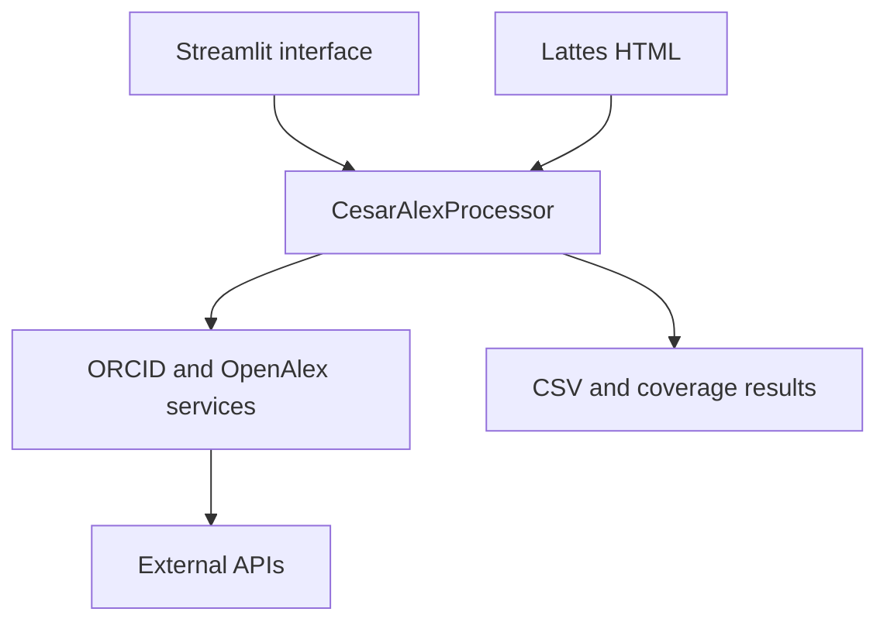

# Architecture and design decisions

## Overview

CesarAlex separates its Streamlit interface from an interface-independent
domain core. This is important for a web research application: the integration
rules can be tested with deterministic providers without starting a browser or
calling external APIs.

## Modules

| Module | Responsibility |
| --- | --- |
| `lattes.py` | Decode and parse Lattes HTML once per uploaded file |
| `normalization.py` | Canonicalize DOI, ORCID, OpenAlex IDs, and matching text |
| `models.py` | Immutable domain records and resolution states |
| `clients.py` | HTTP access, retries, key rotation, pagination, and request caches |
| `matching.py` | Conservative author-name matching and report serialization |
| `profiles.py` | Curriculum-scoped inferred OpenAlex profiles |
| `processor.py` | Source integration and row construction |
| `reporting.py` | Data frames, CSV serialization, and coverage counts |
| `usage.py` | OpenAlex balance and reported-cost calculations |
| `visualizations.py` | Sankey and three-source coverage figures |
| `ui.py` | Streamlit state, controls, progress, and downloads |

## DOI as the integration key

DOI is the primary key because it is shared by Lattes, ORCID, and OpenAlex and
can be normalized deterministically. Text titles are preserved for inspection
but are not used as the principal cross-source equality rule. This reduces
false equivalence caused by spelling, punctuation, language, and metadata
differences. The trade-off is that publications without DOI are outside the
main comparison.

## ORCID and no-ORCID paths

With an ORCID, CesarAlex first retrieves the ORCID and OpenAlex profiles and
builds DOI indexes. Optional singleton DOI requests only cover records that were
not recovered from the profile.

Without an ORCID, the application can preserve the curriculum without making
OpenAlex queries or, when explicitly enabled, resolve DOIs individually. A
strong unique name match may infer an OpenAlex author profile. Subsequent DOIs
are searched in all accepted profile caches before another DOI request is made.
This reduces requests while preserving the rule that a cache miss returns to
OpenAlex and can discover another profile.

## Conservative inference

Name matching uses normalized tokens and explicit scoring rules. An inferred
profile is accepted only for a single strong candidate. The result retains the
real OpenAlex ID and display name, the matching method, and the score so that the
decision can be audited. The heuristic favors precision over recall; it is not
treated as ground truth.

## Cache lifetime

Request and inferred-profile caches live only for the current processing
operation. A persistent cache could save more calls, but would introduce
staleness, invalidation, and personal-data governance concerns. The current
scope keeps runs isolated and behavior easier to reproduce.

## Synchronous processing

External calls are synchronous and use bounded retries and explicit pacing.
Parallel requests could reduce wall-clock time, but would complicate key
rotation, cost visibility, and reproducibility and could increase pressure on
external services. The present design prioritizes predictable behavior and
request minimization.

## Multiple OpenAlex keys and usage monitoring

Keys are parsed in user-provided order. The HTTP client advances to the next key
after a rate-limit response. Balance queries are made separately for each key
and aggregated for display. A cryptographic fingerprint detects a changed key
set without storing the keys in custom session metadata. Keys are not included
in CSV output.

## Extensibility

`CesarAlexProcessor` depends on small provider protocols rather than concrete
HTTP clients. A new data source or local snapshot adapter can implement these
protocols, and core behavior can be tested with in-memory providers. UI and
visualization changes therefore do not need to alter the source-integration
rules.
